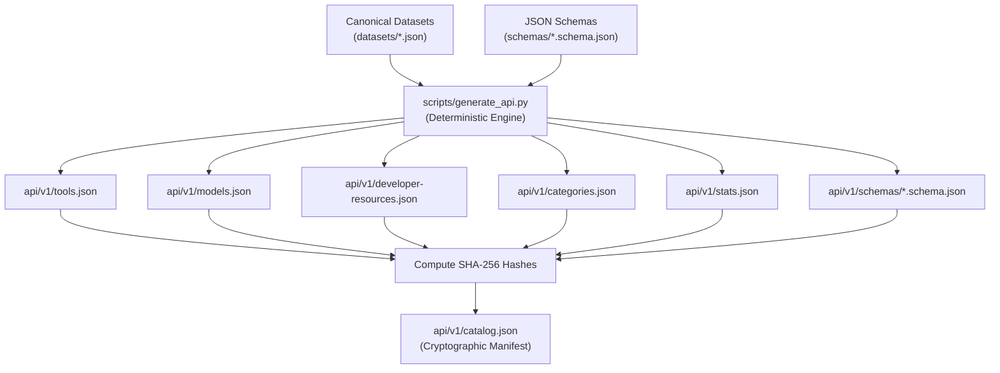

# DevSpire Nexus Registry — Static Artifact Generation Specification

**Specification Version:** 1.0.0  
**Effective Date:** 2026-11-07  
**Build Engine:** `scripts/generate_api.py`  
**Scope:** Deterministic serialization, timestamp isolation, checksum calculation, and drift prevention.

---

## 1. Generation Pipeline & Data Flow



---

## 2. Determinism Requirements

To ensure bit-for-bit identical builds across developer machines (Linux, macOS, Windows) and CI runners:

1. **Key Sorting:** All JSON dictionaries are written with `sort_keys=True`.
2. **Indentation:** Exactly 2 spaces (`indent=2`).
3. **Line Endings:** Strict Unix LF (`\n`). Enforced via binary write mode (`.write_bytes()`) and `.gitattributes`.
4. **Timestamp Isolation:** Volatile wall-clock timestamps (`generated_at`) are **prohibited** in data endpoints (`tools.json`, `models.json`, etc.) and confined strictly to the build manifest `catalog.json`.

---

## 3. How to Run the Generator

```bash
# Execute deterministic generation
python scripts/generate_api.py

# Verify that no uncommitted drift exists in git
git diff --exit-code api/v1/
```

If canonical datasets are modified, `scripts/generate_api.py` must be executed and the resulting `api/v1/` artifacts committed in the same pull request. CI enforces this via `git diff --exit-code api/v1/`.
