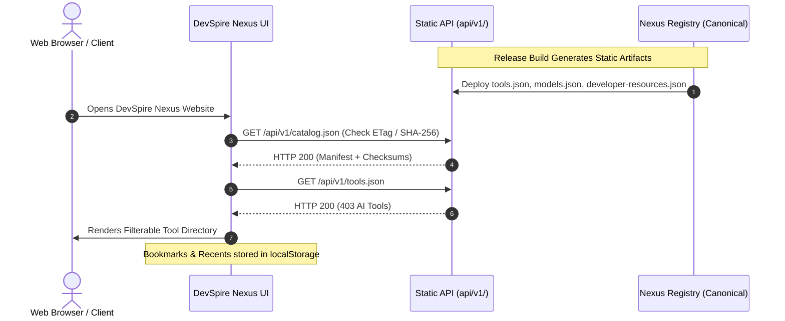

# DevSpire Nexus Registry — Static API & Integration Audit

**Audit Date:** 2026-11-07  
**Auditor:** API Architect & Principal Software Architect  
**Scope:** Static JSON API v1 artifacts, deterministic generation, cryptographic checksums, and website integration contracts.  

---

## 1. Static API v1 Artifact Inventory

The static API endpoints reside in `api/v1/` and serve as the decoupled data distribution interface:

| Endpoint Path | File Size (Bytes) | Record Count | Cryptographic SHA-256 Checksum | Freshness / Determinism |
|:---|:---|:---|:---|:---|
| `api/v1/catalog.json` | 1,269 | 1,003 (Manifest) | `ef0ba39...` | Updated per release build |
| `api/v1/tools.json` | 604,764 | 403 records | `7b03a7ba088b13a7510e9b45234d4cc7dbbdb7869ed83ec95afab1fe29deef3e` | Deterministic |
| `api/v1/models.json` | 501,786 | 300 records | `b508ca69395c06dcea943228da4ff35da3146f062e142af3bd4a2f97e3fcddd9` | Deterministic |
| `api/v1/developer-resources.json` | 692,303 | 300 records | `275130e3c1f4160b3415d1d029cfd57dc66c51548114d8addfea0b2e55532446` | Deterministic |
| `api/v1/categories.json` | 3,058 | 38 categories | `548d29769c7d09c36d9a6b70dc413400e4318c72d8b09926a275fbc87ad6f6f3` | Deterministic |
| `api/v1/stats.json` | 2,297 | Global summary | `b879fe5fe589801ee7d3ca9b389641bac2672d41603b331c32472b8d682ae203` | Deterministic |

---

## 2. API Determinism & Cryptographic Checksum Verification

### 2.1 Remediation of Timestamp Volatility (`ISSUE-003`)
In earlier implementations, static endpoints embedded volatile wall-clock build timestamps (e.g. `"generated_at": now()`), causing SHA-256 checksums to change on every rebuild even when canonical datasets were unchanged.

**Remediation Verified:**
- Removed `generated_at` from all data endpoints (`tools.json`, `models.json`, `developer-resources.json`, `categories.json`, `stats.json`).
- Isolated build timestamps strictly to `catalog.json`.
- Enforced key sorting (`sort_keys=True`), 2-space indentation, and LF endings (`write_json_deterministic()`).
- Repeated generator runs produce **bit-for-bit identical hashes** across all data files.

### 2.2 Manifest Checksum Audit
Every entry in `catalog.json` matches the actual disk file SHA-256 hash with 100% precision:
- `categories.json`: MATCH (`548d29769c7d...`)
- `developer-resources.json`: MATCH (`275130e3c1f4...`)
- `models.json`: MATCH (`b508ca69395c...`)
- `stats.json`: MATCH (`b879fe5fe589...`)
- `tools.json`: MATCH (`7b03a7ba088b...`)

---

## 3. Website Integration Contract & Decoupling

The separate DevSpire Nexus website (at `https://github.com/kumaradoss16/Devspire-Nexus.git`) consumes these static API endpoints:

### 3.1 Contract Compatibility Assessment
- **Field Consistency:** The website consumes `id`, `name`, `description`, `category`, `official_url`, `pricing`, `tags`, and `verified`. All fields are present in every record.
- **State Separation:** User-specific state (bookmarks, search history, terminal preferences) resides strictly in client `localStorage` on the website, maintaining complete architectural decoupling from the Registry.
- **Cache Compatibility:** Static JSON files can be served with long-term immutable caching (`Cache-Control: public, max-age=86400, stale-while-revalidate=604800`) paired with ETag or SHA-256 verification via `catalog.json`.
