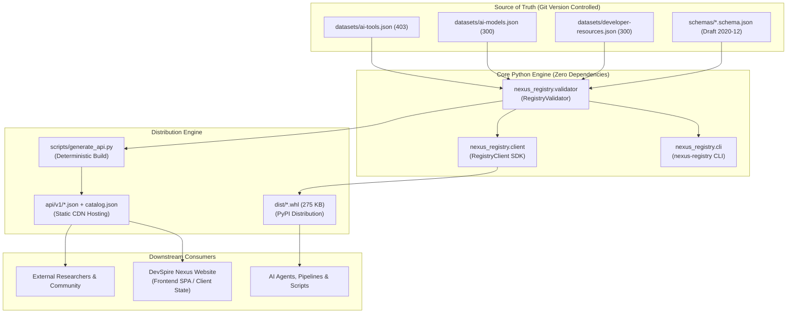

# DevSpire Nexus Registry — Architecture & Scalability Assessment

**Audit Date:** 2026-11-07  
**Auditor:** Principal Software Architect  
**Scope:** Architectural boundaries, separation of concerns, data modeling, maintainability, and scalability limits.  

---

## 1. System Architecture & Topology

DevSpire Nexus Registry is designed as an **authoritative, static-first data infrastructure repository**. It serves as the single source of truth for AI Tools, AI Models, and Developer Resources, while deliberately avoiding backend database servers, dynamic microservices, or complex cloud dependencies.

---

## 2. Evaluation of Key Architectural Dimensions

| Dimension | Architectural Implementation | Evaluation | Assessment |
|:---|:---|:---|:---|
| **Separation of Concerns** | Strict decoupling between canonical registry (data ownership) and website (presentation/user bookmarks). | Clean boundary. No frontend state or session tokens bleed into the registry. | **EXCELLENT** |
| **Dependency Footprint** | Core SDK and CLI have `dependencies = []` (zero runtime dependencies). | Eliminates dependency conflict risk for embedding into external Python apps. | **EXCELLENT** |
| **Data Model Consistency** | All records inherit from `common.schema.json` via Draft 2020-12 `$defs` and `allOf`. | Normalized schema across tools, models, and dev resources with strict typing. | **HIGH** |
| **Build Determinism** | Explicit LF endings, sorted keys, fixed indent, wall-clock timestamps isolated to `catalog.json`. | Produces bit-for-bit identical SHA-256 hashes across repeated generation runs. | **HIGH** |
| **Offline First** | Packaged datasets inside `src/nexus_registry/data/` resolved via `importlib.resources`. | SDK and CLI function 100% offline without network calls or local server processes. | **EXCELLENT** |
| **Maintainability** | Clean modularity across `client.py` (querying), `validator.py` (validation), and `cli.py` (interface). | Highly readable code, comprehensive type hints, < 1,500 total lines of code. | **HIGH** |

---

## 3. Scalability Analysis & Growth Thresholds

The current static JSON file architecture is evaluated against increasing dataset scales:

| Scale Threshold | Resource Records | File Size (Est.) | Architecture Performance & Viability | Recommended Strategy |
|:---|:---|:---|:---|:---|
| **Current Scale** | **1,003 records** | ~1.85 MB total | Instant in-memory load (< 15ms), search < 2ms, zero server costs. | **Current Static JSON (Optimal)** |
| **Medium Scale** | **5,000 records** | ~9.2 MB total | Loads in ~60ms; memory overhead < 40 MB; CLI and SDK remain instantaneous. | **Retain Static JSON** with gzip/brotli compression on static CDN. |
| **Large Scale** | **25,000 records** | ~46 MB total | Full JSON parse takes ~250ms. Search latency ~15ms in pure Python. | Introduce optional **SQLite / DuckDB** build artifact alongside JSON. |
| **Massive Scale** | **100,000+ records** | ~180 MB total | Unsuitable for single monolithic JSON fetch on frontend. | Implement chunked categorical JSON endpoints or indexed SQLite downloads. |

### Architectural Conclusion on Database Infrastructure:
Introducing relational databases (PostgreSQL, MySQL), Redis caches, or live REST/GraphQL backend servers is **premature and unwarranted** at the current scale of 1,003 to 10,000 records. The static-file and Python wheel architecture provides superior reliability, 100% uptime, zero hosting cost, complete offline capability, and trivial multi-region CDN caching.

---

## 4. Modularity and Code Quality Observations

1. **Typing & Linting:**
   - Full Python 3 type annotations (`Dict[str, Any]`, `Optional[Path]`, `List[str]`) are used across all public methods.
2. **Path Resolution Robustness:**
   - The fallback logic in `resolve_datasets_dir` seamlessly bridges three distinct execution contexts: editable developer checkout, git clone root, and standalone `site-packages` installation.
3. **API Versioning Strategy:**
   - Directory structure `api/v1/` establishes a clear URI namespace. Future breaking schema migrations can be released in `api/v2/` without breaking existing `v1` consumer integrations.
