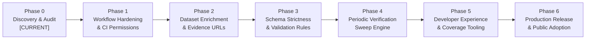

# DevSpire Nexus Registry — Phased Remediation Roadmap

**Audit Date:** 2026-11-07  
**Auditor:** Principal Software Architect & Release Engineer  
**Status:** Strategic Roadmap for Post-Audit Implementation.  
**Execution Constraint:** **AUDIT ONLY — Do NOT implement tasks during Phase 0.**

---

## 1. Remediation Phase Overview

---

## 2. Phase-by-Phase Remediation Plan

### Phase 1: CI/CD Workflow Hardening & Least Privilege
- **Objective:** Eliminate residual workflow security risks in GitHub Actions.
- **Issues Addressed:** `AUD-002`.
- **Priority:** **High Priority / Required before public adoption.**
- **Implementation Tasks:**
  1. Update `.github/workflows/link-check.yml` to include `permissions: contents: read`.
  2. Pin requests dependency: `pip install requests==2.32.3`.
- **Files Affected:** `.github/workflows/link-check.yml`.
- **Dependencies:** None.
- **Risks:** Zero risk of breaking changes.
- **Acceptance Criteria:** Workflow passes syntax validation and executes with least-privilege token.
- **Approval Gate:** Approval by DevSecOps Engineer.

---

### Phase 2: Metadata Enrichment & Repository Link Backporting
- **Objective:** Enrich developer resource records where GitHub links exist in evidence but are missing in top-level fields.
- **Issues Addressed:** `AUD-004`.
- **Priority:** **Medium Priority.**
- **Implementation Tasks:**
  1. Inspect `whisper-cpp-api`, `llama-cpp-server`, and `fastembed-gpu` in `datasets/developer-resources.json`.
  2. Populate `repository_url` from verified evidence arrays.
  3. Regenerate static API endpoints via `python scripts/generate_api.py`.
- **Files Affected:** `datasets/developer-resources.json`, `api/v1/developer-resources.json`, `api/v1/catalog.json`.
- **Dependencies:** None.
- **Risks:** Checksum update required in `catalog.json`.
- **Acceptance Criteria:** `nexus-registry validate` passes with 0 errors; API reproducibility tests pass.
- **Approval Gate:** Approval by Data Governance Specialist.

---

### Phase 3: Schema Strictness & Conditional Validation (v1.1.0)
- **Objective:** Prevent contributor field typos and enforce open-source license consistency.
- **Issues Addressed:** `AUD-005`.
- **Priority:** **Medium Priority / Post-v1.0.0 Enhancement.**
- **Implementation Tasks:**
  1. Add `additionalProperties: false` to record schemas.
  2. Add JSON Schema `if/then` conditional rule: if `open_source: true`, `license` must not be null.
  3. Validate against all 1,003 records to ensure zero regressions.
- **Files Affected:** `schemas/*.schema.json`, `src/nexus_registry/validator.py`.
- **Dependencies:** Phase 2 data enrichment.
- **Risks:** May reject malformed contributor PRs (intended behavior).
- **Acceptance Criteria:** 1,003 records remain 100% compliant; synthetic invalid schema test catches unknown fields.
- **Approval Gate:** Approval by API Architect.

---

### Phase 4: Automated Periodic Verification Sweep
- **Objective:** Prevent staleness of verification timestamps and detect domain churn early.
- **Issues Addressed:** `AUD-006`.
- **Priority:** **Medium Priority.**
- **Implementation Tasks:**
  1. Extend `scripts/check_links.py` to support an optional full-sweep batch mode (`--full-sweep`).
  2. Create a quarterly scheduled GitHub Action workflow (`.github/workflows/quarterly-audit.yml`).
  3. Output automated health reports to `reports/quarterly-link-audit.json`.
- **Files Affected:** `scripts/check_links.py`, `.github/workflows/`.
- **Dependencies:** None.
- **Risks:** Network rate-limiting from external target sites.
- **Acceptance Criteria:** Link checker respects rate limits, logs HTTP status codes, and creates non-blocking summary reports.
- **Approval Gate:** Approval by DevSecOps Engineer & QA Lead.

---

### Phase 5: Developer Experience & Local Coverage Tooling
- **Objective:** Standardize local development scripts and code coverage metrics.
- **Issues Addressed:** `AUD-007`.
- **Priority:** **Low Priority / Operational Polish.**
- **Implementation Tasks:**
  1. Add a `scripts/run_coverage.py` helper script that executes `coverage run -m unittest discover -s tests` and outputs terminal report.
  2. Document coverage commands in `docs/release-process.md`.
- **Files Affected:** `scripts/run_coverage.py`, `docs/release-process.md`.
- **Dependencies:** `pip install coverage` in optional dev extras.
- **Risks:** None.
- **Acceptance Criteria:** Running the coverage script outputs structured test coverage metrics.
- **Approval Gate:** Approval by QA Lead.

---

### Phase 6: Production Release & Public Adoption
- **Objective:** Formal release of `nexus-registry` v1.0.0 to PyPI and announcement to open-source community.
- **Priority:** **Milestone Gate.**
- **Implementation Tasks:**
  1. Tag Git release `v1.0.0`.
  2. Publish source distribution and wheel (`dist/nexus_registry-1.0.0-py3-none-any.whl`) to PyPI.
  3. Verify `pip install nexus-registry` from public index in clean Docker container.
  4. Ensure GitHub Pages or CDN serves `api/v1/` endpoints under custom domain.
- **Files Affected:** Release metadata, git tags.
- **Dependencies:** Phases 1–2 completion.
- **Acceptance Criteria:** External developers can install and consume registry data globally.
- **Approval Gate:** Repository Owner Sign-Off.

---

## 3. Prioritization & Classification Summary

| Priority Level | Remediation Task | Target Milestone | Blocker for Public Release? |
|:---|:---|:---|:---|
| **High Priority** | Phase 1: CI/CD Workflow Hardening (`AUD-002`) | Immediate post-audit | **Yes** |
| **High Priority** | Phase 2: Metadata Enrichment (`AUD-004`) | Immediate post-audit | No (Recommended) |
| **Medium Priority**| Phase 3: Schema Strictness (`AUD-005`) | v1.1.0 Release | No |
| **Medium Priority**| Phase 4: Periodic Verification Sweep (`AUD-006`) | v1.1.0 Release | No |
| **Low Priority**   | Phase 5: Local Coverage Tooling (`AUD-007`) | Ongoing maintenance | No |
| **Milestone**      | Phase 6: Production Release & PyPI Publishing | v1.0.0 Milestone | Target |
