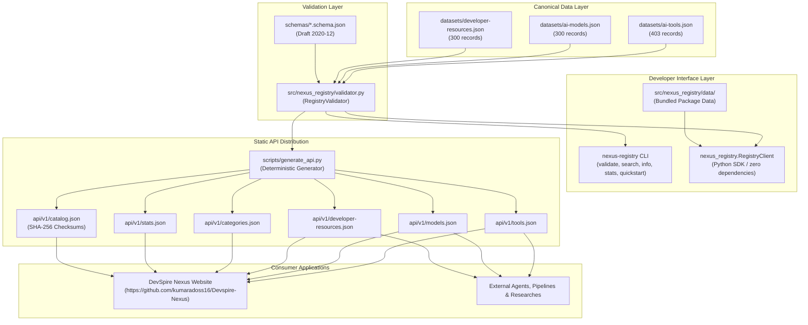

# DevSpire Nexus Registry — Repository Inventory

**Audit Date:** 2026-11-07  
**Auditor:** DevSpire Nexus Architecture & Engineering Audit Team  
**Scope:** Repository topology, technologies, modules, data flow, dependencies, and configuration.  
**Repository Remote:** `https://github.com/kumaradoss16/DevSpire-Nexus-Registry.git`  
**Local Root:** `H:\DevSpire-Nexus-Registry`  

---

## 1. Repository Directory Structure

```
DevSpire-Nexus-Registry/
├── .git/                                 # Git version control metadata
├── .github/                              # GitHub automation & community templates
│   ├── ISSUE_TEMPLATE/
│   │   ├── bug_report.yml                # Bug report issue template
│   │   ├── data_correction.yml           # Structured dataset error / correction template
│   │   ├── resource_submission.yml       # New resource contribution template
│   │   └── resource_update.yml           # Existing resource metadata update template
│   ├── workflows/
│   │   ├── link-check.yml                # Weekly bounded external link health checker
│   │   ├── tests.yml                     # Multi-version Python unit test matrix (3.10 - 3.13)
│   │   └── validate.yml                  # Canonical schema validation, drift check & wheel smoke test
│   └── PULL_REQUEST_TEMPLATE.md          # Standard PR checklist and validation requirements
├── api/                                  # Versioned static JSON API distribution artifacts
│   └── v1/
│       ├── catalog.json                  # API manifest with record counts & SHA-256 hashes (1,269 B)
│       ├── categories.json               # Categorized taxonomy lookup endpoints (3,058 B)
│       ├── developer-resources.json      # 300 developer resources canonical endpoint (692,303 B)
│       ├── models.json                   # 300 AI models canonical endpoint (501,786 B)
│       ├── stats.json                    # Registry global and categorical metrics (2,297 B)
│       └── tools.json                    # 403 AI tools canonical endpoint (604,764 B)
├── datasets/                             # Canonical authoritative source datasets
│   ├── ai-models.json                    # 300 AI Model records (517,338 B)
│   ├── ai-tools.json                     # 403 AI Tool records (623,149 B)
│   └── developer-resources.json          # 300 Developer Resource records (711,332 B)
├── docs/                                 # Technical, governance, and architecture documentation
│   ├── audit/                            # Formal engineering audit deliverables
│   ├── adding-a-resource.md              # Contributor guide for adding records
│   ├── architecture.md                   # System topology and separation of concerns
│   ├── cli-reference.md                  # Comprehensive nexus-registry CLI manual
│   ├── data-model.md                     # JSON Schema and attribute specification
│   ├── governance.md                     # Data stewardship and editorial governance
│   ├── licensing-policy.md               # Dual-license architecture details
│   ├── release-process.md                # Tagging, packaging, and publishing manual
│   ├── schema-versioning.md              # Semantic versioning policies for schemas
│   ├── verification-guide.md             # Evidence gathering and verification manual
│   ├── verification-policy.md            # Provenance and evidence standards
│   └── website-integration.md            # Integration manual for consumer websites
├── examples/                             # External integration code samples
│   ├── curl/                             # Static API cURL query examples
│   └── python/                           # Python SDK client scripts
├── reports/                              # Automated audit & data quality output
│   ├── data-quality-report.json          # Machine-readable evidence archetype analysis (787 B)
│   └── data-quality-report.md            # Human-readable evidence audit summary (1,863 B)
├── schemas/                              # Authoritative JSON Schemas (Draft 2020-12)
│   ├── ai-model.schema.json              # Schema extension for AI models (2,227 B)
│   ├── ai-tool.schema.json               # Schema extension for AI tools (1,075 B)
│   ├── common.schema.json                # Base schema contract for all resources (4,222 B)
│   └── developer-resource.schema.json    # Schema extension for developer resources (5,371 B)
├── scripts/                              # Maintenance, validation, and generation tooling
│   ├── check_links.py                    # Bounded sampling external link checker (2,736 B)
│   ├── generate_api.py                   # Deterministic static API generation script (6,091 B)
│   ├── generate_quality_report.py        # Evidence taxonomy quality auditor (8,057 B)
│   └── migrate_data.py                   # Dataset migration & normalization utility (6,488 B)
├── src/                                  # Source distribution package root
│   └── nexus_registry/                   # nexus_registry Python package
│       ├── __init__.py                   # Package exports (__version__ = "1.0.0")
│       ├── cli.py                        # Command-line interface implementation (8,681 B)
│       ├── client.py                     # Python SDK RegistryClient implementation (7,336 B)
│       ├── validator.py                  # Schema and integrity validator implementation (13,342 B)
│       └── data/                         # Bundled package data for offline pip distribution
│           ├── datasets/                 # Packaged copy of canonical datasets
│           │   ├── ai-models.json
│           │   ├── ai-tools.json
│           │   └── developer-resources.json
│           └── schemas/                  # Packaged copy of JSON schemas
│               ├── ai-model.schema.json
│               ├── ai-tool.schema.json
│               ├── common.schema.json
│               └── developer-resource.schema.json
├── tests/                                # Automated unit test suite
│   ├── test_api_reproducibility.py       # Checksum and deterministic generation tests (1,770 B)
│   ├── test_cli.py                       # CLI argument and subcommand tests (1,694 B)
│   ├── test_client.py                    # Python SDK query, filter & search tests (2,174 B)
│   ├── test_datasets.py                  # Canonical dataset integrity tests (4,948 B)
│   ├── test_schemas.py                   # JSON Schema compliance tests (1,883 B)
│   ├── test_standalone.py                # Standalone wheel pip install tests (1,160 B)
│   └── test_validator.py                 # Validation engine and error reporting tests (2,500 B)
├── .gitattributes                        # Git LF line-ending normalization config (186 B)
├── .gitignore                            # Standard Python & OS ignore rules (679 B)
├── ATTRIBUTION.md                        # Citation and credit requirements (1,677 B)
├── CHANGELOG.md                          # Release history and migration notes (1,699 B)
├── CITATION.cff                          # Machine-readable academic citation metadata (680 B)
├── CODE_OF_CONDUCT.md                    # Contributor Covenant Code of Conduct (2,831 B)
├── CONTRIBUTING.md                       # Contribution workflows and guidelines (2,729 B)
├── DATA_LICENSE.md                       # ODC-By v1.0 data license (1,698 B)
├── LICENSE                               # MIT source code license (1,123 B)
├── pyproject.toml                        # PEP 517/518/621 build configuration (1,916 B)
├── README.md                             # Project overview, badges, SDK & CLI quick starts (7,327 B)
├── SECURITY.md                           # Security vulnerability reporting policy (1,812 B)
├── SUPPORT.md                            # Issue triage and community support policy (865 B)
└── THIRD_PARTY_CONTENT.md                # Nominative trademark fair use policy (1,979 B)
```

---

## 2. Technology Stack & Environment

| Component | Technology | Specification / Version | Verified Status |
|:---|:---|:---|:---|
| **Language Runtime** | Python | `>=3.10` (Tested on 3.10, 3.11, 3.12, 3.13) | Active runtime: Python 3.13.13 |
| **Build Backend** | Setuptools | `setuptools>=61.0` (PEP 517/621 `pyproject.toml`) | Verified wheel build (275 KB) |
| **Runtime Dependencies** | None | Zero third-party dependencies (`dependencies = []`) | 100% standard library |
| **Optional Dev Dependencies** | jsonschema, pytest | `jsonschema>=4.20.0`, `pytest>=8.0.0` | Fallback validator works without jsonschema |
| **CLI Framework** | `argparse` | Python Standard Library | Full subcommand suite implemented |
| **Schema Standard** | JSON Schema | Draft 2020-12 (`https://json-schema.org/draft/2020-12/schema`) | Fully compliant |
| **Packaging & Data** | `importlib.resources` | PEP 302/366 package data resolution | Embedded in `src/nexus_registry/data/` |
| **API Format** | Static JSON | UTF-8, deterministic sorting, Unix LF endings | Hosted statically on CDN/GitHub Pages |
| **Test Framework** | `unittest` | Python Standard Library | 30 tests running in 0.54s |
| **CI/CD Platform** | GitHub Actions | Workflows: `tests.yml`, `validate.yml`, `link-check.yml` | Strict `contents: read` permissions |

---

## 3. Important Files & Roles

| File Path | Size (Bytes) | Role & Architectural Purpose |
|:---|:---|:---|
| `pyproject.toml` | 1,916 | Package metadata, entry points (`nexus-registry`), classifiers, package-data configuration. |
| `src/nexus_registry/client.py` | 7,336 | Public Python SDK interface (`RegistryClient`) for searching, loading, and inspecting resources. |
| `src/nexus_registry/validator.py` | 13,342 | Validation engine checking required fields, regex slug formats, enums, and URL validity. |
| `src/nexus_registry/cli.py` | 8,681 | Command-line interface parsing subcommands and formatting human-readable terminal output. |
| `scripts/generate_api.py` | 6,091 | Generates static API endpoints and cryptographically verified `catalog.json` manifest. |
| `scripts/check_links.py` | 2,813 | Politeness-bounded sampling link checker for external URLs. |
| `scripts/generate_quality_report.py` | 8,057 | Data quality analyzer classifying evidence into 7 distinct archetypes. |
| `datasets/ai-tools.json` | 623,149 | 403 canonical AI application records. |
| `datasets/ai-models.json` | 517,338 | 300 canonical AI model records. |
| `datasets/developer-resources.json` | 711,332 | 300 canonical developer framework and library records. |
| `schemas/common.schema.json` | 4,222 | Authoritative base schema for all registry entities. |

---

## 4. End-to-End Data Flow



---

## 5. Build, Test, and Packaging Verification

1. **Local editable install:**
   ```bash
   pip install -e .
   ```
2. **Execute full test suite:**
   ```bash
   python -m unittest discover -s tests
   # Ran 30 tests in 0.541s -> OK
   ```
3. **Execute CLI dataset validation:**
   ```bash
   python -m nexus_registry.cli validate
   # 1003 resources checked -> PASS [OK] Errors: 0 | Warnings: 0
   ```
4. **Build distribution wheel:**
   ```bash
   python -m pip install wheel
   pip wheel --no-deps -w dist .
   # Produces dist/nexus_registry-1.0.0-py3-none-any.whl (275 KB)
   ```
5. **Standalone package verification:**
   Installing the 275 KB wheel in a separate, isolated directory outside the git checkout successfully loads all 1,003 records and executes search queries without missing data files.

---

## 6. Initial Architectural Observations

1. **Zero Runtime Dependency Architecture:** The Python SDK and CLI rely exclusively on standard library modules (`importlib.resources`, `json`, `pathlib`, `argparse`, `hashlib`, `urllib`). This eliminates dependency conflict risks in consumer environments.
2. **Draft 2020-12 Schema Rigor:** All schemas declare `$schema: https://json-schema.org/draft/2020-12/schema` and use `$defs` and `allOf` references to enforce schema consistency across entities.
3. **Deterministic Output:** `generate_api.py` enforces sorted keys, strict 2-space indentation, explicit LF line endings, and cryptographic checksum tracking in `catalog.json`.
4. **Clear Decoupling:** The registry owns canonical metadata; consumer websites (like DevSpire Nexus) consume versioned static API artifacts without back-channel coupling.
