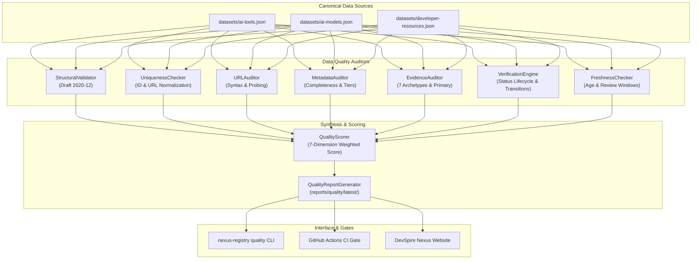

# DevSpire Nexus Registry — Data Quality Framework

**Specification Version:** 1.0.0  
**Effective Date:** 2026-11-07  
**Status:** Canonical Engineering Policy  
**Scope:** Architecture, dimensions, validation pipeline, and operational gates of the Data Quality Infrastructure.

---

## 1. System Vision & Objectives

The DevSpire Nexus Registry Data Quality Framework enforces rigorous standards for canonical datasets representing AI Tools, AI Models, and Developer Resources. The quality architecture guarantees that every record indexed in the catalog is:

1. **Structurally Valid:** Compliant with authoritative JSON Schema Draft 2020-12 contracts.
2. **Uniquely Identifiable:** Free of identifier, slug, or destination URL collisions across all registries.
3. **Evidence-Backed:** Substantiated by traceable, verifiable primary source citations.
4. **Complete and Fresh:** Maintained within active freshness review windows with complete mandatory attributes.
5. **Independently Auditable:** Verifiable by automated CI pipelines and third-party developers without hidden state.

---

## 2. Framework Architecture

The framework consists of eight coordinated logical components implemented in `src/nexus_registry/quality/`:

---

## 3. The Seven Quality Dimensions

The catalog's operational health is evaluated across seven distinct, measurable dimensions:

| Dimension | Weight | Target | Metric Measured |
|:---|---:|---:|:---|
| **Structural Validity** | 20% | 100.0% | Percentage of records passing JSON Schema Draft 2020-12 validation without errors. |
| **Identity Integrity** | 15% | 100.0% | Absence of duplicate IDs, duplicate slugs, and cross-registry collisions. |
| **URL Integrity** | 10% | 100.0% | Percentage of official and evidence URLs conforming to RFC 3986 syntax. |
| **Metadata Completeness**| 15% | >= 95.0% | Weighted presence of mandatory and operational metadata attributes. |
| **Evidence Coverage** | 15% | 100.0% | Percentage of records containing at least one traceable primary source link. |
| **Verification Integrity**| 15% | >= 98.0% | Adherence of `status: "verified"` records to primary evidence standards. |
| **Freshness** | 10% | >= 90.0% | Verification date compliance within configured review intervals. |
| **Composite Score** | **100%** | **>= 95.0%** | Standardized 100-point composite score. |

---

## 4. Operational Gates & Release Enforcement

The framework enforces two non-negotiable operational gates before any dataset or release artifact is certified:

1. **The Critical Structural Gate:**
   - If any canonical record fails schema validation, the Structural Validity score is set to 0.0, and the entire catalog is flagged as `STRUCTURAL_GATE_FAILED`.
   - **Enforcement:** No high scores in other dimensions can override a structural failure. Release builds are automatically blocked.
2. **The Identity Collision Gate:**
   - If any within-registry or cross-registry identifier duplicate exists, the Identity Integrity score is set to 0.0, and `has_identity_conflicts` is set to `true`.
   - **Enforcement:** Prevents duplicate record generation or silent overwrite in downstream consumers.
