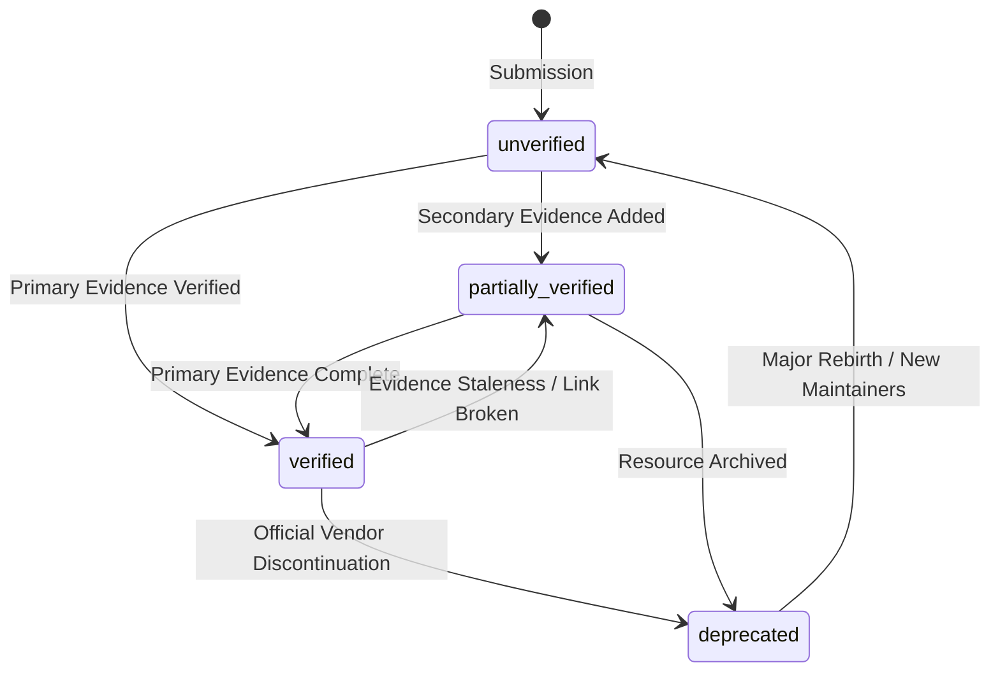

# DevSpire Nexus Registry — Verification Policy

**Policy Version:** 1.0.0  
**Effective Date:** 2026-11-07  
**Scope:** Verification status definitions, minimum evidence standards, and status transition rules.

---

## 1. Verification Status Definitions

Every resource record indexed in the DevSpire Nexus Registry is assigned one of four canonical verification statuses:

```
┌─────────────────────────────────────────────────────────────────────────┐
│                        Verification Status Model                        │
├────────────────────┬────────────────────────────────────────────────────┤
│ `verified`         │ Required claims have primary evidence, passed      │
│                    │ editorial review, valid date, and active URL.      │
├────────────────────┼────────────────────────────────────────────────────┤
│ `partially_        │ Some important claims are supported, but evidence  │
│ verified`          │ coverage is incomplete or secondary.               │
├────────────────────┼────────────────────────────────────────────────────┤
│ `unverified`       │ New submission; verification has not been          │
│                    │ completed or evidence is insufficient.             │
├────────────────────┼────────────────────────────────────────────────────┤
│ `deprecated`       │ Resource is discontinued, replaced, or no longer   │
│                    │ recommended for active production use.             │
└────────────────────┴────────────────────────────────────────────────────┘
```

---

## 2. Minimum Criteria for `status: "verified"`

A resource may be assigned `status: "verified"` **only if all of the following conditions are satisfied**:

1. **Structural Conformance:** The record passes JSON Schema validation with 0 errors.
2. **Primary Evidence:** The record contains at least one verified primary source link (Official Website, Official Documentation, Source Repository, Model Card, or Package Registry).
3. **Traceable Date:** The `verified` field contains a valid ISO-8601 calendar date (`YYYY-MM-DD`).
4. **Domain Consistency:** The domain of the evidence links matches the claimed publisher or official vendor domain.
5. **No Active Contradictions:** No unresolved dispute, major pricing mismatch, or critical bug is open against the resource.

---

## 3. Allowed Status Transitions



---

## 4. Verification Invalidation Policy

A record must be demoted from `verified` to `partially_verified` or `unverified` if:
1. The official website or repository returns a persistent HTTP 404/410 status code.
2. Core commercial pricing tiers change substantially without corresponding dataset updates.
3. The verification timestamp exceeds 365 days without a scheduled review.
